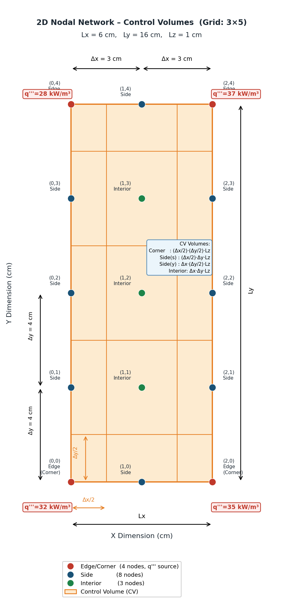
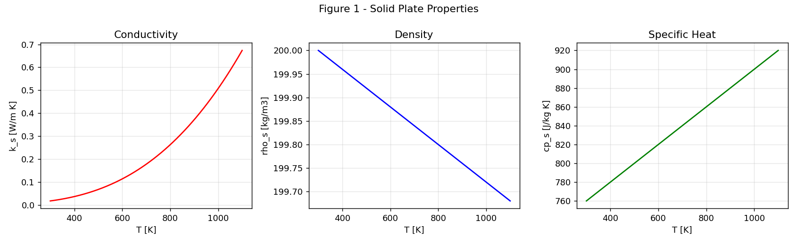
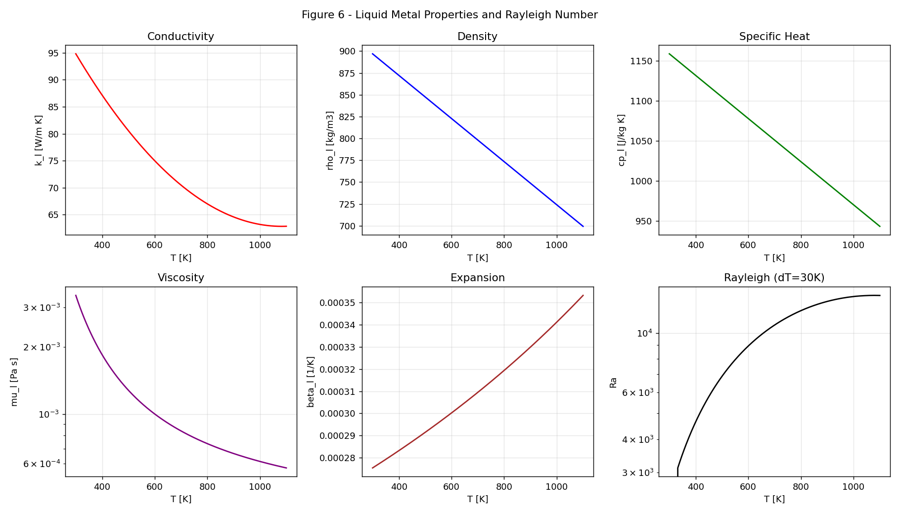
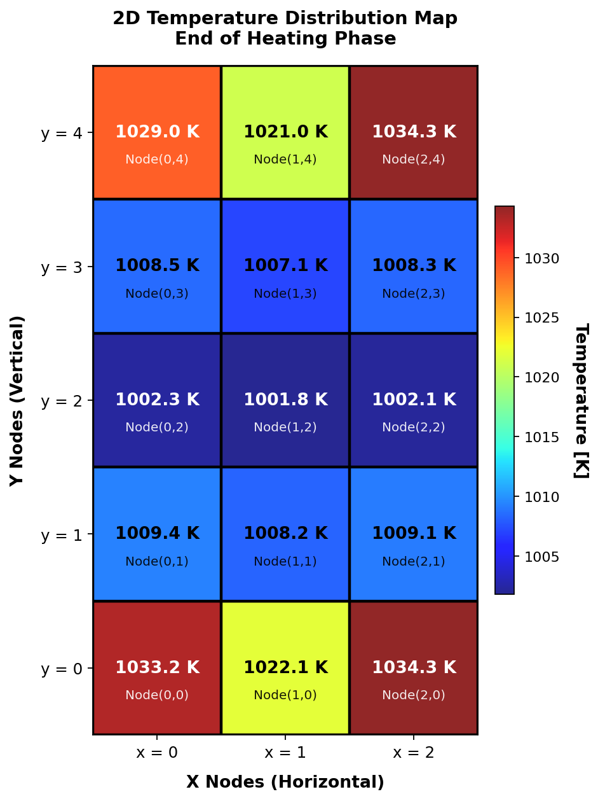
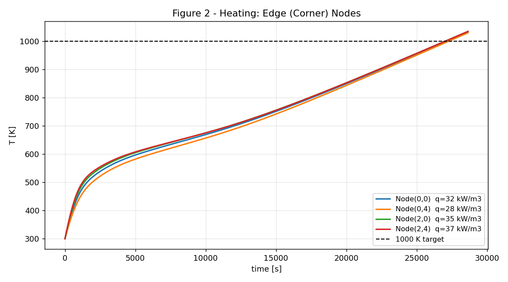
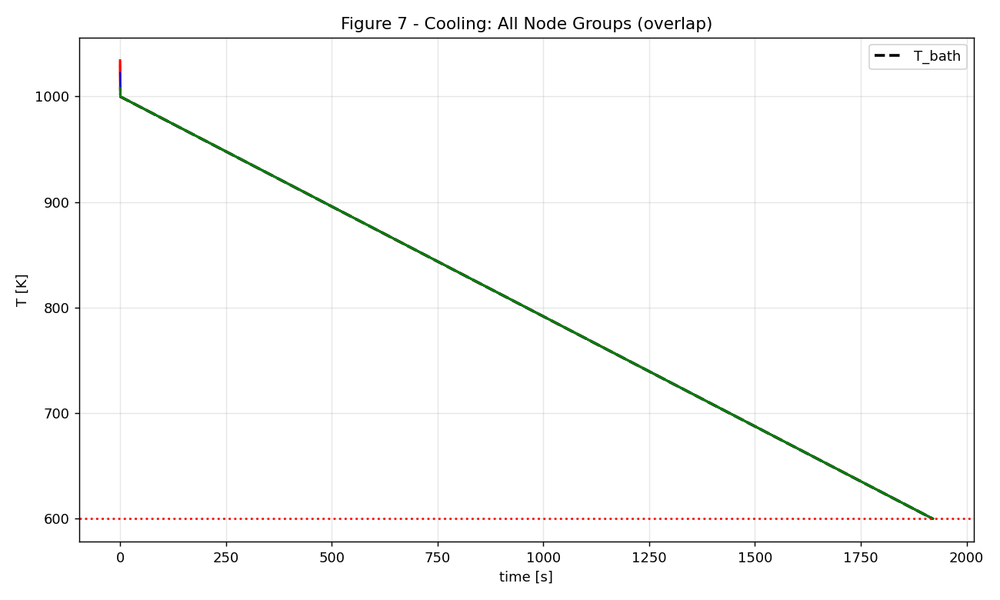

# 2D Transient Thermal Analysis of a Rectangular Plate

Two-stage transient (time-dependent) two-dimensional heat-transfer analysis of a
rectangular plate, solved with the **Control Volume Finite Difference Method
(CVFDM)** and an **explicit Euler** time-integration scheme in pure Python.

> NEM 394 Engineering Project III — Hacettepe University, Department of Nuclear Engineering.

---

## Problem Description

A `6 cm × 16 cm × 1 cm` plate is discretized on a **3 × 5 node grid**
(`Δx = 3 cm`, `Δy = 4 cm`) and undergoes a two-stage heat treatment:

1. **Heating phase** — the plate is heated from `300 K` by four local, variable
   volumetric heat sources (`28–37 kW/m³`) applied through spring clamps at its
   four corners, under fully **adiabatic** boundaries, until *every* node reaches `1000 K`.

2. **Cooling phase** — the heated plate is immersed in a **liquid-metal bath**
   whose temperature decreases linearly in time. With no heat generation, all six
   faces lose heat by **natural convection**, with the convection coefficient
   computed locally from the **Rayleigh number** at each node and time step,
   until every node cools below `600 K`.

The thermophysical properties of **both** the solid plate and the liquid-metal
coolant (`k`, `ρ`, `cₚ`, `μ`, `β`, …) are **temperature dependent** and are
re-evaluated at every node on every time step, making the governing equations
strongly non-linear.

<p align="center"></p>

---

## Method

* **Control Volume Finite Difference Method (CVFDM):** boundary and corner nodes
  own half / quarter control volumes; interior nodes own a full cell.
* **Conduction** between adjacent nodes uses the arithmetic mean of the interface
  conductivities (Fourier's law).
* **Explicit Euler** time stepping — each node is updated independently, making it
  straightforward to incorporate temperature-dependent properties.
* **Stability:** the heating step is capped by the diffusion limit at maximum
  diffusivity (1000 K); the cooling step is re-derived from the local convection +
  conduction terms (high Biot number ⇒ very small `Δt`).
* **Natural convection:** separate Nusselt correlations for horizontal top/bottom
  faces and vertical side faces (incl. Churchill–Chu), all functions of the local Ra.

<table>
<tr>
<td width="50%"><br><sub><b>Solid plate properties</b> — k, ρ, cₚ vs. temperature.</sub></td>
<td width="50%"><br><sub><b>Liquid-metal properties</b> & Rayleigh number vs. temperature.</sub></td>
</tr>
</table>

---

## Results Gallery

**Temperature distribution at the end of the heating phase** — every node has exceeded the 1000 K target:

<p align="center"></p>

<table>
<tr>
<td width="50%"><br><sub><b>Heating phase</b> — corner (clamp) node temperatures rising to 1000 K.</sub></td>
<td width="50%"><br><sub><b>Cooling phase</b> — all node groups tracking the falling bath temperature.</sub></td>
</tr>
</table>

---

## Key Results

| Quantity | Value |
| :--- | :--- |
| Heating stability limit `Δt_max` | ≈ `102 s` |
| Time for all nodes to reach 1000 K | ≈ `28 643 s` (≈ `7.96 hours`) |
| Hottest node after heating | `(2,0)` — `1034.3 K` |
| Slowest (coldest) node after heating | `(1,2)` — `1001.8 K` |
| Cooling stability limit `Δt` | ≈ `0.017 s` (Bi ≫ 1) |
| Time for all nodes to drop below 600 K | ≈ `1920 s` (≈ `32 min`) |

The very small cooling time step and the residual lag between the plate and the
bath confirm that internal conduction resistance dominates surface convection
resistance (`Bi ≫ 1`), placing the system well outside the lumped-capacitance regime.

Full derivations, discussion and the Star-CCM+ comparison are in the
[project report](docs/2D_Transient_Thermal_Analysis_Report.pdf).

---

## Repository Contents

| File | Description |
| :--- | :--- |
| `thermal_analysis.py` | Main solver: Part A (stability), Part B (heating), Part C (time-step study), Part D (cooling) + Figures 1–8. |
| `node_diagram.py` | Methodology schematic of the 3×5 nodal network and control volumes. |
| `temperature_heatmap.py` | Color-coded map of the final nodal temperatures after heating. |
| `requirements.txt` | Python dependencies (`numpy`, `matplotlib`). |
| `images/` | Pre-generated figures used in this README. |
| `docs/2D_Transient_Thermal_Analysis_Report.pdf` | Full project report (NEM 394 Final Project). |

---

## Running

```bash
pip install -r requirements.txt

python thermal_analysis.py      # full simulation, prints results, saves Figures 1-8
python node_diagram.py          # saves node_diagram_final.png
python temperature_heatmap.py   # saves temperature_heatmap.png
```

---

## Author

**Emre Sakarya** — Nuclear Engineering, Hacettepe University (Student ID: 2230386062).
